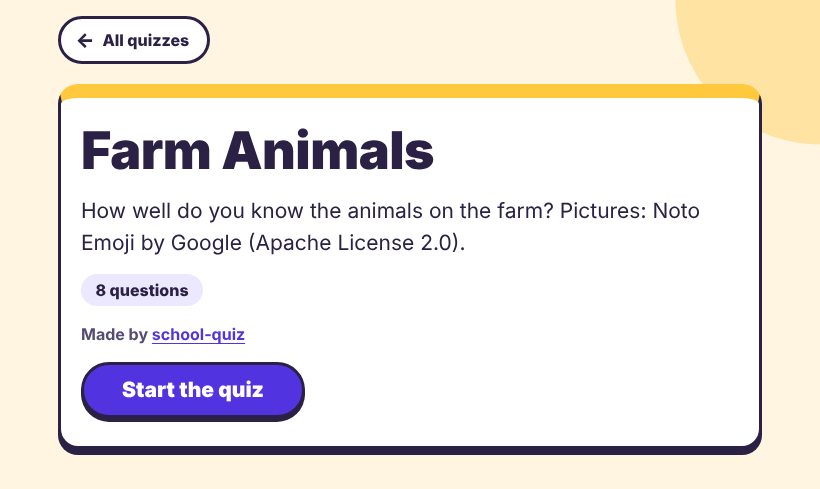
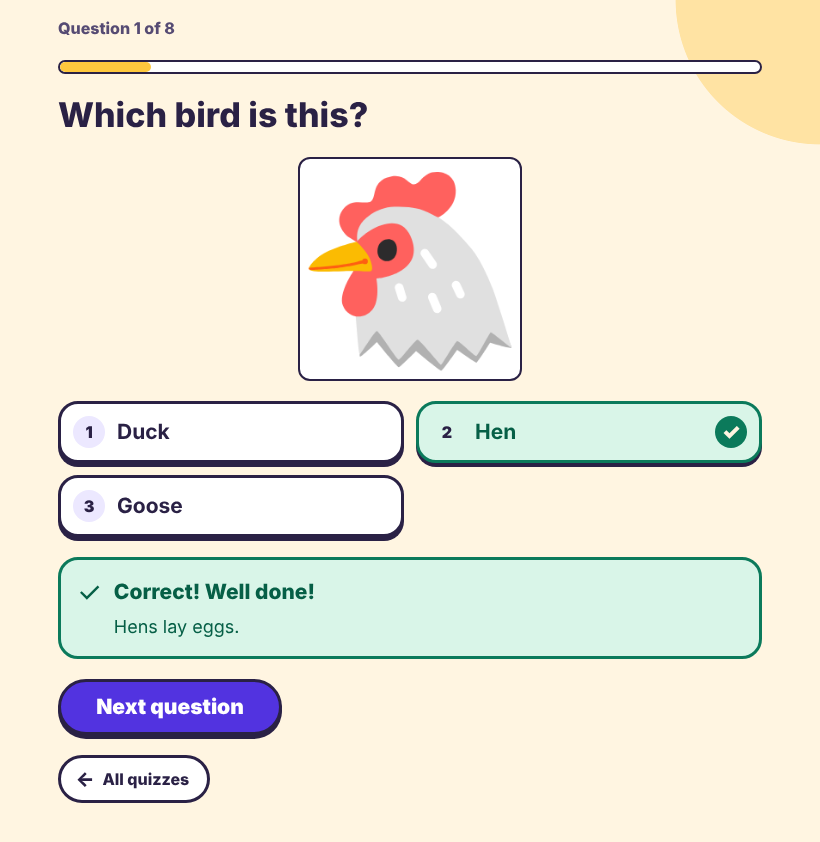
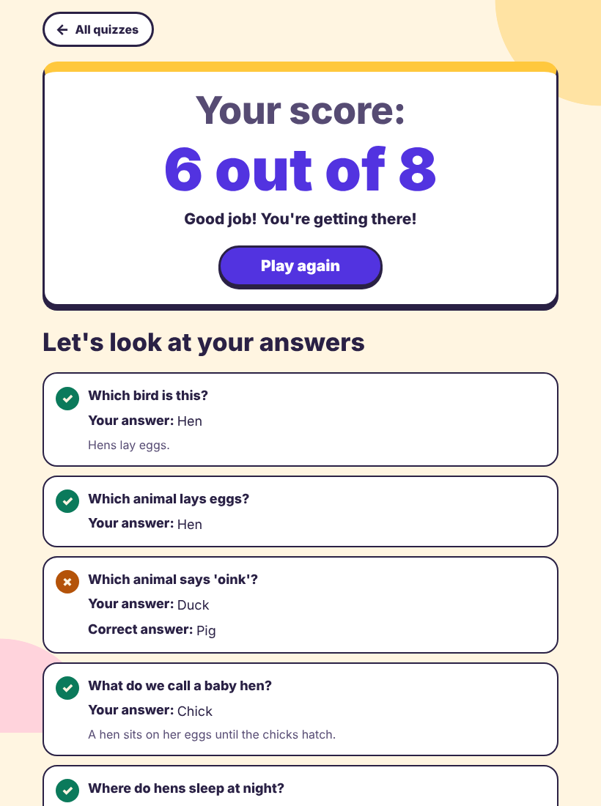
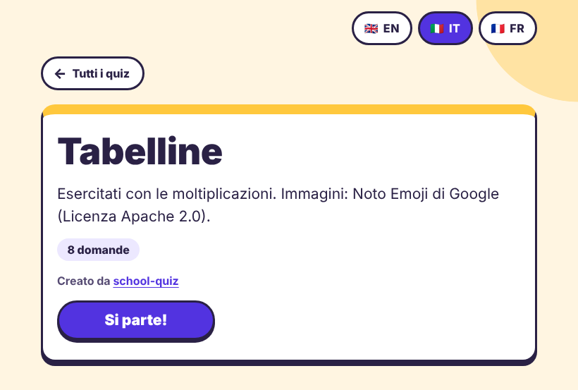
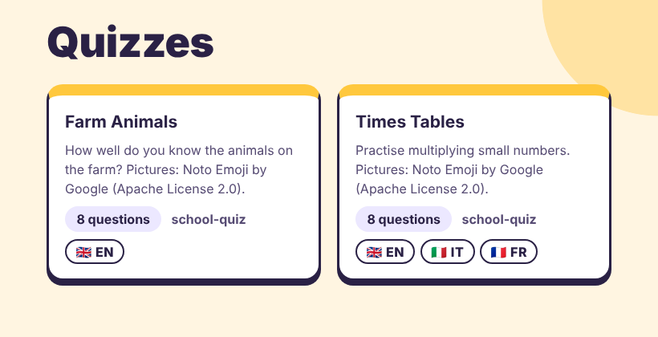

# school-quiz (`quizgen`)

**Free, simple quizzes for kids. Write questions in a plain text file, get a web page they can play on a phone, tablet or computer.**

| Start screen | Question, after "Check" | End screen |
|---|---|---|
|  |  |  |

| Language switcher (Italian) | Quiz index of a site |
|---|---|
|  |  |

**Live demo:** <https://rcocetta.github.io/school-quiz/> (try the [quizzes](https://rcocetta.github.io/school-quiz/quizzes/) or read the [guide](https://rcocetta.github.io/school-quiz/guide/)).

**Which path are you?** Teacher or parent who does not want to install anything: follow the [step-by-step guide](https://rcocetta.github.io/school-quiz/guide/) (fork the repository, edit your quiz in the browser on GitHub, then publish it with GitHub Pages). Comfortable with a terminal: read [Quick start](#quick-start) and [Writing a quiz](#writing-a-quiz), then [Publishing](#publishing-on-github-pages). Developer: jump to [Development](#development) and [CONTRIBUTING.md](CONTRIBUTING.md).

## Our promise

- **Built for kids.** Big buttons, clear text, a kind tone when an answer is wrong, no ads, no accounts, no tracking.
- **Free forever.** Licensed under the GPL-3.0 (or any later version). Nobody can take it away or put it behind a paywall.
- **Make it your own.** Anyone can fork this project and run their own quiz site for their class, school or family.
- **Give back.** Found a bug, wrote a good quiz or translated the interface? Send it to us with a pull request. See [CONTRIBUTING.md](CONTRIBUTING.md).

## Contents

1. [Features](#features)
2. [Quick start](#quick-start)
3. [Installation](#installation)
4. [Writing a quiz](#writing-a-quiz)
5. [Multiple languages](#multiple-languages)
6. [Validation](#validation)
7. [Command line reference](#command-line-reference)
8. [Output modes](#output-modes)
9. [Publishing on GitHub Pages](#publishing-on-github-pages)
10. [Editor support](#editor-support)
11. [FAQ and limitations](#faq-and-limitations)
12. [Privacy](#privacy)
13. [Adding a new interface language](#adding-a-new-interface-language)
14. [Development](#development)
15. [Contributing, licence and credits](#contributing-licence-and-credits)

## Features

- Quizzes are plain text files (JSON). One file is one quiz. It can hold many questions; each attempt shows a smaller number of them, picked at random, so every try is different.
- Multiple choice with exactly one right answer. Answers can be text, pictures, or both.
- Two feedback styles: tell the child right away (they tap an answer, then press "Check my answer"), or show everything at the end.
- Options are shuffled for every attempt (switch off with `"shuffle_options": false`).
- An optional explanation per question, shown after the answer.
- End screen with the score, an encouraging message, a review of every answer and "Play again" (a new random set).
- Several languages in one quiz, with a flag-and-code switcher that keeps the child's place. Interface text comes in English, Italian, Spanish, French and German.
- Replace any button or message text with your own (`ui`).
- Say who made a quiz (`author`) and group quizzes into collections.
- Two outputs: **one self-contained HTML file** (works offline, easy to email) or **a whole website** with an index page.
- Checks your files and tells you where the problem is and how to fix it.
- No backend, no tracking, and no requests to other sites (except `https://` pictures you choose to link). Pages carry strict browser safety rules (a Content-Security-Policy).
- Built for keyboard and screen-reader use, and for phones and tablets; not yet tested with real screen readers or real tablets (see the [FAQ](#faq-and-limitations)).

## Quick start

You need Python 3.10 or newer and [pipx](https://pipx.pypa.io/) (see [Installation](#installation) if you need help with a terminal or pipx). Five steps:

**1. Install quizgen** (in a terminal):

```bash
pipx install git+https://github.com/rcocetta/school-quiz
```

**2. Save this as `my-quiz.json`** (any text editor will do):

<!-- file: my-quiz.json -->
```json
{
  "title": "Capitals",
  "questions": [
    {
      "text": "What is the capital of France?",
      "options": [
        { "text": "Paris", "correct": true },
        { "text": "Rome" },
        { "text": "Madrid" }
      ]
    }
  ]
}
```

**3. Check it:**

```bash
quizgen validate my-quiz.json
```

**4. Build it** (writes `my-quiz.html` next to it):

```bash
quizgen build my-quiz.json
```

**5. Open `my-quiz.html`** in a browser (double-click it). Done. It is a single file you can email or put on a USB stick.

Prefer not to install anything? Follow the [guide](https://rcocetta.github.io/school-quiz/guide/): fork this repository, edit your quiz in the browser on GitHub, then publish it with GitHub Pages. See also [Publishing on GitHub Pages](#publishing-on-github-pages).

## Installation

quizgen is not on PyPI. Install it straight from GitHub. It needs Python 3.10 or newer; the only dependencies are `jsonschema` and `jinja2`.

**Opening a terminal.** Windows: open the Start menu, type `PowerShell` and press Enter. macOS: press Cmd+Space, type `Terminal` and press Enter. Linux: press Ctrl+Alt+T, or look for "Terminal" in your applications. Type (or paste) each command and press Enter.

**With pipx** (recommended: gives you the `quizgen` command without touching your other Python packages):

```bash
pipx install git+https://github.com/rcocetta/school-quiz
```

This needs Git on your computer. If you do not have Git, install from a download of the code instead:

```bash
pipx install https://github.com/rcocetta/school-quiz/archive/refs/heads/main.zip
```

**If `pipx` is not found:** on Debian or Ubuntu run `sudo apt install pipx`. Elsewhere run `python3 -m pip install --user pipx` and then `python3 -m pipx ensurepath` (on Windows use `py -m pip install --user pipx` and `py -m pipx ensurepath`). Then close the terminal, open a new one and try again.

**With pip, in a virtual environment:**

```bash
python3 -m venv .venv
source .venv/bin/activate          # Windows: .venv\Scripts\activate
pip install git+https://github.com/rcocetta/school-quiz
```

**From source, for developers:**

```bash
git clone https://github.com/rcocetta/school-quiz
cd school-quiz
python3 -m venv .venv
.venv/bin/pip install -e '.[dev]'
```

Check it works: `quizgen --help` should list the `build` and `validate` commands. If you installed from source, `quizgen validate examples/` also checks the example quizzes.

To upgrade a pipx install, run `pipx upgrade quizgen`. To install a particular version, add `@<tag-or-commit>` to the end of the GitHub address.

## Writing a quiz

A quiz is a text file ending in `.json`. The smallest useful quiz is the one in the [quick start](#quick-start): a `title`, and `questions`, each with a `text` and its `options`, with `"correct": true` on the right one.

JSON is picky about punctuation: text in double quotes, commas between items but not after the last one, curly braces `{ }` around objects and square brackets `[ ]` around lists. If you get it wrong, `quizgen validate` tells you the line and column. Ready-made examples to copy are in [`examples/`](examples/).

A fuller single-language quiz. It uses a picture: download [`cow.png`](https://github.com/rcocetta/school-quiz/blob/main/examples/images/cow.png) ("Download raw file" button) into an `images/` folder next to the file, or delete the `"image"` and `"image_alt"` lines:

<!-- file: farm.json -->
```json
{
  "$schema": "https://raw.githubusercontent.com/rcocetta/school-quiz/main/src/quizgen/schema.json",
  "title": "Farm Animals",
  "description": "How well do you know the animals on the farm?",
  "language": "en",
  "questions_per_quiz": 2,
  "feedback": "immediate",
  "shuffle_options": true,
  "author": { "name": "Ms Rossi", "url": "https://example.org" },
  "questions": [
    {
      "text": "What do we call a baby cow?",
      "image": "images/cow.png",
      "image_alt": "A brown and white cow standing in a field",
      "explanation": "A baby cow is called a calf.",
      "options": [
        { "text": "Calf", "correct": true },
        { "text": "Foal" },
        { "text": "Lamb" }
      ]
    },
    {
      "text": "Which animal gives us wool?",
      "options": [
        { "text": "Pig" },
        { "text": "Sheep", "correct": true },
        { "text": "Hen" }
      ]
    },
    {
      "text": "Which animal lays eggs?",
      "options": [
        { "text": "Cow" },
        { "text": "Horse" },
        { "text": "Hen", "correct": true }
      ]
    }
  ]
}
```

### Field reference

This section follows `src/quizgen/schema.json` exactly. Any field not listed is an error, which catches typos such as `corect`.

**Text** means: a plain string in a single-language quiz, or a map from language code to string in a [multi-language quiz](#multiple-languages).

#### Quiz (top level)

| Field | Type | Required | Default | Notes |
|---|---|---|---|---|
| `$schema` | string | no | none | Ignored by the tool. Gives your editor autocomplete ([Editor support](#editor-support)). |
| `title` | Text | yes | none | Shown on the start screen and in the index. |
| `description` | Text | no | none | Shown on the start screen and on the index card. |
| `languages` | list of strings, at least 1, no repeats | no | none | Turns on [multi-language mode](#multiple-languages). The first entry is the starting language. |
| `language` | string | no | `"en"` | Single-language mode only; an error together with `languages`. Picks the language of the buttons and messages. |
| `questions_per_quiz` | integer, at least 1 | no | the smaller of 10 and the number of questions | M, the number of questions in each attempt. |
| `feedback` | `"immediate"` or `"end"` | no | `"immediate"` | See [Feedback modes](#feedback-modes). |
| `shuffle_options` | true or false | no | `true` | Shuffle the answer order on every attempt. |
| `author` | Author | no | the collection's or site's author, if any | See [Author object](#author-object) and [Saying who made it](#saying-who-made-it). |
| `ui` | object | no | none | Replace built-in screen text. See [Changing the built-in text](#changing-the-built-in-text-ui). |
| `questions` | list of Question, at least 1 | yes | none | N is the length of this list. |

#### Question

| Field | Type | Required | Default | Notes |
|---|---|---|---|---|
| `text` | Text | yes | none | The question. |
| `image` | image reference | no | none | A relative path or an `https://` link. See [Images](#images). |
| `image_alt` | Text | no | none | Describes the image for screen readers. An error without `image`. |
| `explanation` | Text | no | none | Shown after the answer (and in the review). |
| `options` | list of Option, at least 2 | yes | none | Exactly one must have `"correct": true`. |

#### Option

| Field | Type | Required | Default | Notes |
|---|---|---|---|---|
| `text` | Text | no | none | At least one of `text` and `image` is needed. |
| `image` | image reference | no | none | A picture answer, with or without text. |
| `image_alt` | Text | no | none | Describes the image. An error without `image`. |
| `correct` | true or false | no | `false` | Mark exactly one option per question as `true`. |

#### Author object

| Field | Type | Required | Notes |
|---|---|---|---|
| `name` | string | yes | Shown as "Made by ...". |
| `url` | string | no | Must start with `http://` or `https://`. Makes the name a link. |
| `email` | string | no | A simple `name@host.tld` shape. Used as a `mailto:` link only when there is no `url`. |

Authors are always plain strings, even in multi-language quizzes. Unknown keys are errors.

**Image reference**: a relative path (from the folder holding the JSON file) or an `http://` / `https://` link. See [Images](#images).

### Saying who made it

```json
"author": { "name": "Ms Rossi", "url": "https://example.org/class-4b" }
```

The name appears on the start screen ("Made by Ms Rossi") and on index cards, and links to the `url` (or, if there is none, the `email`). A quiz without `author` inherits the author of its collection; a loose quiz inherits the site's author from `site.json`.

Advice:

- Prefer a website address over an email. Pages are public, and a published email address attracts spam.
- If you give an email, make it a role address (for example a class or project mailbox), not your personal one.
- Never put children's names or contact details in a quiz, an author field or an image.

### Images

```jsonc
{ "text": "Cow", "image": "images/cow.png", "image_alt": "" }                    // text + picture
{ "image": "images/cow.png", "image_alt": "A brown and white animal with horns" } // picture only
```

- **Local images** sit next to your quiz, usually in an `images/` folder, and are written relative to the JSON file. Allowed types: `png`, `jpg`, `jpeg`, `gif`, `webp`. SVG is not allowed (see the [FAQ](#faq-and-limitations)).
- Each local image can be at most **5 MB**. The file's content must match its extension (a renamed document is rejected). In single-file mode all inlined images together must stay under **20 MB** per page. Small pictures (a few hundred pixels wide) load fastest on school tablets.
- Paths must stay inside the quiz folder: no `..`, no absolute paths, no `\`, no `./`, no links (symlinks, which are shortcuts to files elsewhere).
- **Remote images** are `https://` links. They are never copied or checked. Only `https://` loads: an `http://` link produces a warning because the page will not display it.
- **Privacy:** a remote image is fetched by the child's browser, so the image host can see their IP address. Local images avoid this, so prefer them. Use a remote image only from a host you trust.
- Make sure you may use the picture. Note the source and licence (see [CONTRIBUTING.md](CONTRIBUTING.md) for quizzes shared in this repository).

#### Describing images (`image_alt`)

`image_alt` is the text a screen reader reads instead of the picture. It is a Text, so in a multi-language quiz it needs a translation per language like any other text. The one exception is marking a picture as decoration: write a plain `"image_alt": ""` even in a multi-language quiz. A map such as `{"any": ""}` or `{"en": ""}` is an error, because an empty text counts as a missing translation.

- Needs an `image` in the same question or option; otherwise it is an error.
- `"image_alt": ""` means "this picture is decoration". Allowed on a question image, and on an option image that sits next to text. Not allowed on an option that is only a picture, because the child could not tell the options apart.
- A question image, or a picture-only option, without `image_alt` gives a warning.
- Fallback in the browser when `image_alt` is missing: a question image is treated as decoration, an option image uses the option text, and a picture-only option is called "Picture 1", "Picture 2", ... (the `picture_n` text).

**How to write good alt text**

- Describe what you see, not the answer. If the picture *is* the question ("Which animal is this?"), never name the thing in the alt text: say "A brown and white animal with horns".
- Use `""` (empty) when the picture is only decoration, or when the text next to it already says everything.
- For picture-only options, describe what makes each one different from the others.
- If the picture contains words or numbers that matter, put them in the alt text or in the question.
- One short sentence. Do not start with "Picture of" or "Image of".
- In a multi-language quiz, translate it like any other text.
- Test: read the quiz aloud to someone, with the pictures hidden. Can they still answer?

### Feedback modes

- `"immediate"` (default): the child taps an answer (they can change their mind), then presses **Check my answer**. The right answer and the explanation (if any) appear, then **Next question**.
- `"end"`: the child picks an answer and moves on. Nothing is marked until the end screen, which reviews every question.

On a keyboard, number keys 1 to 9 pick an option while focus is inside the options. They only select; pressing "Check" or "Next" confirms.

### Shuffling

Questions are always drawn at random from the pool. Options are shuffled for every attempt unless you set `"shuffle_options": false` (useful for questions like "All of the above", or ordered answers such as 1, 2, 3).

### Choosing how many questions to ask

Two numbers matter: **N**, the number of questions in the file, and **M**, the number of questions asked in each attempt (`questions_per_quiz`).

- If you leave `questions_per_quiz` out, M is 10, or N if you have fewer than 10 questions.
- A quiz with more questions than M gives variety: each attempt is a different random selection. For a pool of 30, an M of 10 is a good start.
- M larger than N is an error when you set it yourself. M equal to N works but gives a warning: every attempt has the same questions, only in a different order.
- `quizgen build --questions 5` overrides M for every quiz in that build.

### Changing the built-in text (`ui`)

Every button and message has a default (for example "Start the quiz" or "Next question"). Replace any of them with a `ui` object on a quiz or in `collection.json`. Priority: the quiz wins over its collection, which wins over the built-in text. Overrides apply to quiz pages. Index pages always use the built-in text of the site language.

<!-- file: ui-quiz.json -->
```json
{
  "title": "Capitals",
  "ui": {
    "start": "Let's go!",
    "correct": "Spot on!",
    "messages": {
      "great": "Star student!",
      "keep_trying": "Every try makes you better!"
    }
  },
  "questions": [
    {
      "text": "What is the capital of France?",
      "options": [
        { "text": "Paris", "correct": true },
        { "text": "Rome" }
      ]
    }
  ]
}
```

You may override any subset of keys. In a multi-language quiz each value is a map with any subset of the quiz languages, plus optionally `any`; languages you leave out keep the built-in text:

<!-- file: ui-multi.json -->
```json
{
  "languages": ["en", "it"],
  "title": { "any": "Capitals" },
  "ui": {
    "correct": { "en": "Spot on!", "it": "Esatto!" },
    "messages": { "great": { "any": "🌟🌟🌟" } }
  },
  "questions": [
    {
      "text": { "en": "What is the capital of France?", "it": "Qual è la capitale della Francia?" },
      "options": [
        { "text": { "any": "Paris" }, "correct": true },
        { "text": { "any": "Rome" } }
      ]
    }
  ]
}
```

Rules: values must not be empty; a plain string is an error in a multi-language quiz and a map is an error in a single-language one; a `{placeholder}` that the original text does not have is an error; leaving out a placeholder the original has gives a warning (the screen may look incomplete). Keep text friendly, short and gender-neutral.

| Key | Built-in (English) | Placeholders | Where it appears |
|---|---|---|---|
| `start` | Start the quiz | | Start button |
| `next` | Next question | | Button after each question |
| `finish` | See my results | | Button after the last question |
| `try_again` | Play again | | End screen button |
| `check` | Check my answer | | Button in immediate-feedback mode |
| `question_x_of_y` | Question {current} of {total} | `{current}`, `{total}` | Progress above each question |
| `questions_count` | {count} questions | `{count}` | Start screen |
| `questions_count_one` | 1 question | | Start screen, when there is 1 |
| `made_by` | Made by {name} | `{name}` | Author line |
| `made_with` | Made with school-quiz | | Footer link |
| `your_score` | Your score: | | End screen |
| `score_x_of_y` | {score} out of {total} | `{score}`, `{total}` | End screen |
| `correct` | Correct! Well done! | | Feedback after a right answer (also read out in the review) |
| `wrong` | Not quite! | | Feedback after a wrong answer (also read out in the review) |
| `the_answer_was` | The right answer is: | | Feedback after a wrong answer |
| `your_answer` | Your answer | | Review list |
| `correct_answer` | Correct answer | | Review list |
| `review` | Let's look at your answers | | Heading of the review list |
| `choose_language` | Choose language | | Label of the language switcher |
| `picture_n` | Picture {n} | `{n}` | Screen-reader name of an unlabelled picture option |
| `back_to_all` | All quizzes | | Link back to the index (site mode) |
| `messages.great` | Amazing! You really know your stuff! | | End message, score 80% or more |
| `messages.good` | Good job! You're getting there! | | End message, 50% to 79% |
| `messages.keep_trying` | Keep practising, you will get better every time! | | End message, below 50% |

The keys `quizzes`, `quizzes_count`, `quizzes_count_one`, `collections`, `no_quizzes_yet` and `languages` are used by index pages only. They are accepted in `ui` but have no visible effect, because `ui` applies to quiz pages. `name` and `flag` (the language's own name and flag) cannot be overridden.

### Collections and folder layout

A **collection** is a subfolder with quizzes inside, for example one teacher's or one school's set. Each collection gets its own index page. Only one level of subfolders is supported.

```text
quizzes/
├── site.json                 # optional: title, description, author, language of the whole site
├── farm-animals.json         # a loose quiz (listed on the main index)
├── times-tables.json         # another loose quiz
├── images/
│   └── cow.png
└── class-4b/                 # a collection
    ├── collection.json       # optional
    ├── tables.json
    └── images/...
```

Reserved names, checked by `quizgen validate` and `quizgen build`:

- A quiz cannot be called `index.json` (that name is used for the index page).
- A collection folder cannot be called `assets` or end in `.html` (any case).
- `collection.json` only belongs inside a collection folder; `site.json` only at the top.
- Two quizzes in the same folder, or two collection folders, whose names differ only in upper/lower case (`Maths.json` and `maths.json`): Windows and macOS treat them as the same file.
- JSON files that are symlinks, and names that are not valid UTF-8, are refused.
- Hidden files and folders (starting with `.`) are skipped, as is `schema.json` and any `*.schema.json`.

#### `site.json` (optional, top level of the folder)

| Field | Type | Required | Default | Notes |
|---|---|---|---|---|
| `$schema` | string | no | none | Editor help only. |
| `title` | string | no | the word "Quizzes" in the site language | Heading of the main index. At least 1 character. |
| `description` | string | no | none | Shown under the heading. |
| `author` | Author | no | none | Inherited by loose quizzes (quizzes in collections inherit only their collection's author). |
| `language` | string | no | `en` | Language of the index text (headings, counts, "All quizzes"). |

All values are plain strings and are never translated. Unknown keys are errors.

<!-- file: site.json -->
```json
{
  "title": "Our Class Quizzes",
  "description": "Practice for Year 4.",
  "author": { "name": "Ms Rossi", "url": "https://example.org" },
  "language": "en"
}
```

#### `collection.json` (optional, inside a collection folder)

| Field | Type | Required | Default | Notes |
|---|---|---|---|---|
| `$schema` | string | no | none | Editor help only. |
| `title` | string | no | the folder name | Heading of the collection page and its card. |
| `description` | string | no | none | |
| `author` | Author | no | none | Inherited by the collection's quizzes that have no `author`; shown in the collection's header. |
| `language` | string | no | the site's language | Language of this collection's index text. |
| `ui` | object | no | none | Text overrides for the quiz pages in this collection (a quiz's own `ui` wins). Values are plain strings, or a map using language codes or `any`. |

<!-- file: collection.json -->
```json
{
  "title": "Class 4B",
  "description": "Quizzes for 4B.",
  "author": { "name": "Class 4B teachers" },
  "language": "en",
  "ui": { "start": "Ready?" }
}
```

### How a folder becomes a site

The generated site mirrors your folder: the page for `class-4b/tables.json` is `class-4b/tables.html`, and a local image keeps its relative path (so `images/cow.png` is copied to `images/cow.png`). See [Output modes](#output-modes) for the exact tree.

Index entries are sorted by title, ignoring case and accents, with collections first. A collection's card shows its quiz count; a quiz card shows its title in the quiz's first language, its description, question count, language flags and author.

## Multiple languages

Multi-language is opt-in. Without a `languages` field everything is plain text and you never have to think about it.

To switch it on, list the languages and write every piece of text as a map:

<!-- file: colours.json -->
```json
{
  "languages": ["en", "it"],
  "title": { "en": "Colours", "it": "Colori" },
  "questions": [
    {
      "text": { "en": "What colour is the sky?", "it": "Di che colore è il cielo?" },
      "explanation": { "en": "Air scatters blue light the most.", "it": "L'aria diffonde soprattutto la luce blu." },
      "options": [
        { "text": { "en": "Blue", "it": "Blu" }, "correct": true },
        { "text": { "en": "Green", "it": "Verde" } },
        { "text": { "en": "Red", "it": "Rosso" } }
      ]
    }
  ]
}
```

- **One question list, many languages.** The child can switch language in the middle of a quiz without losing their place or score.
- **Everything must be covered.** Every Text must have a value for every language, and empty strings count as missing. A missing translation is an error, never a silent fallback to another language.
- **Plain strings are errors** in multi-language mode (the message suggests `any`). The reverse also holds: a map without a `languages` field is an error.
- `language` and `languages` cannot be used together. `author` fields stay plain strings.
- Every language code must have built-in interface text (see below).

### The `any` key

`"any"` is the value for every language that has no entry of its own. Use it for text that is the same everywhere, such as numbers, names and formulas:

```jsonc
{ "text": { "any": "12" } }                      // 12 in every language
{ "text": { "any": "Rome", "it": "Roma" } }      // "Rome" everywhere except Italian
{ "text": { "any": "Rex", "it": "Rex il cane" } }
```

`"any"` cannot be used as a language code. If a map has `any` and a key for every language, `any` is never used and you get a warning.

### Supported interface languages

| Code | Flag | Language |
|---|---|---|
| `en` | 🇬🇧 | English |
| `it` | 🇮🇹 | Italiano |
| `es` | 🇪🇸 | Español |
| `fr` | 🇫🇷 | Français |
| `de` | 🇩🇪 | Deutsch |

These control the buttons and messages. Your questions can be about anything, but each language code you use in a quiz must be in this list. Missing yours? See [Adding a new interface language](#adding-a-new-interface-language).

### The language switcher

When a quiz has more than one language, every screen shows buttons with the flag and the code (🇬🇧 EN, 🇮🇹 IT). Windows has no flag emoji (it would show "GB"), so pages carry a tiny font with just these flags; browsers that can't use it show their own. Switching redraws the current screen in place and keeps the question, the chosen answer and the score. The choice is remembered in the browser's `localStorage` under the key `quizgen-lang` (and the quiz works fine if storage is blocked).

In a single-language quiz there is no switcher; `language` only sets the interface text (default `en`).

## Validation

`quizgen validate` reads your files and reports every problem at once, each with the file, the place inside it and a hint. `quizgen build` runs the same checks first and writes nothing if anything is wrong.

### What is checked

Errors stop the build:

- **File and structure:** valid JSON (the message gives line and column), required fields present, correct types and allowed values, no unknown fields (typos).
- **Questions:** exactly one `"correct": true` option per question; at least 2 options, each with `text` or `image`; `questions_per_quiz` (or `--questions`) not larger than the number of questions.
- **Languages:** in a multi-language quiz every text covers every language (its own key or `any`) and no plain strings are used; in a single-language quiz no translation maps; `language` and `languages` not mixed; every language code has built-in interface text.
- **Images:** the file exists, stays inside the quiz folder, is png/jpg/jpeg/gif/webp, is 5 MB or less, really is that kind of image; `image_alt` only with an `image`, and not `""` on a picture-only option.
- **Author and `ui`:** `author` has a name, a web address that starts with `http://` or `https://`, and an email that looks like one; `ui` has only known keys, no empty values and no unknown `{placeholders}`.
- **Folders:** reserved names (see [Collections](#collections-and-folder-layout)), linked JSON files and odd file names; `site.json` and `collection.json` are checked too.

Warnings are printed but the build still works:

- `questions_per_quiz` equals the number of questions (same set every time, only the order changes).
- Two options in one question have the same text.
- A text has `any` and every language, so `any` is never used.
- An `http://` image: it will not load, because pages only allow `https://` images.
- A question image, or a picture-only option, has no `image_alt`.
- A `ui` text leaves out a `{placeholder}` the original has.
- A collection folder has no quizzes (it is skipped).

If the structure is wrong, the other checks wait until you fix it; you then see the next group of problems.

### Example output

A quiz with a typo:

```text
$ quizgen validate animals.json
ERROR   animals.json: questions[1].options[0].corect: unknown field "corect" (did you mean "correct"?)
        Fix these first: more checks will run once the structure is right.

1 file(s) checked: 1 error(s), 0 warning(s)
```

After fixing that, the next set of checks runs:

```text
$ quizgen validate animals.json
ERROR   animals.json: questions_per_quiz: questions_per_quiz is 5 but the quiz only has 3 questions; add questions or lower the number
ERROR   animals.json: questions[0].options: exactly one option must have "correct": true (found 0)
ERROR   animals.json: questions[1].image: image file not found: "images/elephant.png" (paths are relative to the quiz file)
warning animals.json: questions[1]: this image has no "image_alt": add a short description of it, or "" if it is only decoration
warning animals.json: questions[2]: this image has no "image_alt": add a short description of it, or "" if it is only decoration
warning animals.json: questions[2].options: duplicate option text "4"

1 file(s) checked: 3 error(s), 3 warning(s)
```

Translation mistakes in a multi-language quiz:

```text
$ quizgen validate colours.json
ERROR   colours.json: questions[0].text: missing translation "it"
ERROR   colours.json: questions[0].options[1].text: plain text is not allowed when "languages" is set; write one text per language, or use {"any": "..."} for text that is the same in every language

1 file(s) checked: 2 error(s), 0 warning(s)
```

Broken JSON:

```text
$ quizgen validate eof.json
ERROR   eof.json: not valid JSON at line 1, column 104: Illegal trailing comma before end of array
```

`questions[1].options[0]` means the first option (counting from 0) of the second question. A file that passes prints `ok` and its name.

### Common errors and fixes

| Message (shortened) | What it means | Fix |
|---|---|---|
| `not valid JSON at line L, column C` | Punctuation mistake near that spot | Look for a missing or extra comma, quote or bracket. The last item in a list has no comma. |
| `unknown field "corect" (did you mean "correct"?)` | A field name is misspelt | Use the suggested name. |
| `exactly one option must have "correct": true (found 0)` or `(found 2)` | A question has no right answer, or several | Mark one option only. |
| `needs at least 2 entries` | A question has fewer than 2 options | Add more options. |
| `questions_per_quiz is 5 but the quiz only has 3 questions` | Asking for more questions than exist | Add questions or lower the number (or remove the field). |
| `missing translation "it"` | A language has no text for this field | Add the `it` text, or use `{"any": "..."}` if it is the same everywhere. |
| `plain text is not allowed when "languages" is set` | A plain string in a multi-language quiz | Turn it into `{"en": "...", "it": "..."}` or `{"any": "..."}`. |
| `translations need a "languages" field` | A map in a single-language quiz | Add `"languages": [...]`, or write plain text. |
| `use either "language" ... or "languages" ...` | Both fields present | Keep one. |
| `no built-in interface translation for "xx"` | Unsupported language code | Use a [supported code](#supported-interface-languages), or [add the language](#adding-a-new-interface-language). |
| `image file not found` | The path is wrong | Paths are relative to the JSON file; check spelling and capital letters. |
| `local images must be one of: png, jpg, jpeg, gif, webp` | Another image type (for example SVG) | Convert to PNG, or link to the picture with an `https://` address. |
| `image path must stay inside the quiz folder` | A path with `..` or starting with `/` | Put the image in or below the quiz's folder. |
| `image is too large (over 5 MB)` | Picture too big | Resize or compress it. |
| `"image_alt": an "image" is needed here` | `image_alt` without `image` | Add the image or remove the `image_alt`. |
| `author.url: must be a web address starting with "http://" or "https://"` | Bad link | Write the full address. |
| `ui.strat: unknown text key "strat" (did you mean "start"?)` | Wrong `ui` key | Use a [key from the table](#changing-the-built-in-text-ui). |
| `{name} cannot be used here (this text can use: none)` | A placeholder the original text does not have | Remove it or use the right one. |
| `a quiz cannot be called index.json` | Reserved name | Rename the file. |
| `rename this folder: "assets" and names ending in ".html" ...` | Reserved folder name | Rename the folder. |
| `"Maths.json" has the same name apart from upper/lower case` | Two names that only differ in capitals | Rename one of them. |
| `warning ... this image will not load: ... use an https:// link` | `http://` image | Use `https://`, or download the picture and use a local file. |

## Command line reference

Both forms are equivalent: `quizgen ...` or `python -m quizgen ...`.

### `quizgen validate <input>...`

Check one or more quiz files and/or folders. Folders are searched for quiz files, `site.json` and `collection.json` (one level of subfolders). Prints one line per problem, `ok <file>` for files without problems, and a summary. An empty folder is fine (a note is printed).

```bash
quizgen validate my-quiz.json
quizgen validate quizzes/ examples/
```

### `quizgen build <input> [-o OUTPUT] [--questions M]`

| Argument | Meaning |
|---|---|
| `input` | A quiz `.json` file (builds one self-contained page) or a folder (builds a website). |
| `-o`, `--output` | For a file: the output `.html` file, or an existing folder or a path ending in `/` (the page is written inside as `<name>.html`). For a folder: the site folder. |
| `--questions M` | Use M questions per attempt in every quiz of this build, instead of `questions_per_quiz`. Must be a whole number; it is validated like any other M. |

Defaults: a file `quiz.json` becomes `quiz.html` next to it; a folder becomes `site/` in the current directory.

```bash
quizgen build my-quiz.json                  # writes my-quiz.html
quizgen build my-quiz.json -o out/          # writes out/my-quiz.html
quizgen build my-quiz.json -o share.html    # writes share.html
quizgen build quizzes/                      # writes site/
quizgen build quizzes/ -o public --questions 5
```

Safety rules: everything is checked before anything is written; nothing is written on error; the quiz file itself is never overwritten; for a folder, the output must not be, be inside, or contain the quiz folder (so `quizgen build .` with the default `site/` is refused, use `-o` with a folder outside), and existing files are never deleted.

### Exit codes

| Code | Meaning |
|---|---|
| `0` | Success. Warnings may have been printed. |
| `1` | At least one error: invalid quiz, missing file or folder, output not allowed, or a write failure. |
| `2` | Wrong command line (unknown command, missing argument, bad `--questions` value). Printed by Python's `argparse`. |

## Output modes

### Single-file mode (`quizgen build quiz.json`)

One `.html` file with the CSS, JavaScript and local images (as `data:` URIs) all inside. Remote image links stay as links.

Use it to email a quiz, hand it out on a USB stick, or open it straight from your disk: it works offline with no server. Opening from disk (`file://`) is supported.

### Site mode (`quizgen build folder/`)

A small static website: an index page, one page per quiz, and shared files. The output mirrors the input folder. For the layout in [Collections and folder layout](#collections-and-folder-layout) with one image, the result is:

```text
site/
├── .nojekyll
├── assets/
│   ├── quiz.css
│   └── quiz.js
├── class-4b/
│   ├── index.html
│   └── tables.html
├── farm-animals.html
├── images/
│   └── cow.png
├── index.html
└── times-tables.html
```

- `index.html` lists collections and loose quizzes. `class-4b/index.html` lists that collection's quizzes. Index pages need no JavaScript.
- Each quiz page links to the shared `assets/quiz.css` and `assets/quiz.js`, and has a link back to the index.
- Local images are copied once to the same relative path as in your folder.
- `.nojekyll` is an empty file that tells GitHub Pages not to run Jekyll over the files.

### Which one should I use?

| I want to... | Use |
|---|---|
| Send one quiz to a parent or colleague | Single file |
| Use a quiz with no internet, or from a USB stick | Single file |
| Publish many quizzes with an index page | Site |
| Put quizzes on GitHub Pages or a school web server | Site |

### Security of the output

Generated pages load no fonts, scripts or analytics from other sites, and make no requests except for `https://` pictures you choose to link. Each page has a strict Content-Security-Policy (a browser safety rule, set in a `<meta>` tag) that enforces this. In single-file mode scripts and styles are allowed only by hash; in site mode only from the site's own `assets/`. Images are allowed from the site itself, `data:` and `https:` links. Quiz text is always inserted as text, never as HTML.

## Publishing on GitHub Pages

The generated site is plain static files, so any static host works.

### Easiest: fork this repository (no install)

If you only want your own quiz site, follow the [guide](https://rcocetta.github.io/school-quiz/guide/). In short: fork the repository, edit or add quiz files in `quizzes/` using GitHub's web editor, then in **Settings > Pages > Build and deployment** set **Source** to **Deploy from a branch**, **Branch** to `main` and the folder to `/docs`, and **Save**. If you later send a quiz back to this project, send it from a fork that still has the sample quizzes, so your pull request doesn't delete them.

The site is served from the committed `docs/` folder, which is generated: after changing `quizzes/` (or `website/`) run `python scripts/build_docs.py` and commit `docs/`. By default it publishes the project website (landing page and guide) with your quizzes at `/quizzes/`. To publish only your quizzes, at the root of your site, run `python scripts/build_docs.py --quizzes-only`. `python scripts/build_docs.py --check` fails when `docs/` is out of date; CI runs it on every pull request. Nothing ever writes to the repository for you, so there are no workflows to switch on.

The rest of this section is for your own repository that is not a fork of this one.

### Manual: build and publish the folder

1. Put your quizzes in a folder, for example `quizzes/`, and run `quizgen build quizzes/ -o docs`. (Keep your JSON files outside `docs/`.)
2. Commit the result to a GitHub repository.
3. In the repository, open **Settings > Pages**. Under **Build and deployment**, choose **Deploy from a branch**, pick your branch and the `/docs` folder, and save.
4. After a minute your site is at `https://<your-user>.github.io/<repository>/`.

(Any other folder works too: build to a separate branch such as `gh-pages` and choose `/ (root)`.) The `.nojekyll` file is included in the output for this setup.

Other hosts work the same way: upload the folder (or the single `.html` file) to Netlify Drop, your school's web space, or any web server.

To test locally before publishing: `python3 -m http.server --bind 127.0.0.1 -d docs` and open http://127.0.0.1:8000. (Use the folder you built into; the default is `site`.)

### Keeping docs/ up to date

Build into `docs/` whenever your quizzes change and commit the result: `quizgen build quizzes/ -o docs`. Use **Deploy from a branch** (`main`, `/docs`) as above. To make sure you never forget, add a step to your own CI that runs `quizgen build quizzes/ -o /tmp/site` and compares it with `docs/` (`diff -r /tmp/site docs`).

## Editor support

Add a `$schema` line at the top of a quiz and editors such as VS Code will autocomplete field names, check types and show descriptions as you type:

```json
{
  "$schema": "https://raw.githubusercontent.com/rcocetta/school-quiz/main/src/quizgen/schema.json",
  "title": "My quiz",
  "questions": [
    {
      "text": "What is 2 + 2?",
      "options": [{ "text": "4", "correct": true }, { "text": "5" }]
    }
  ]
}
```

If you cloned the repository, you can point at the file instead: the schema ships inside the package at `src/quizgen/schema.json`, for example `"$schema": "../src/quizgen/schema.json"` for a quiz in `examples/`. `collection.schema.json` and `site.schema.json` sit next to it for `collection.json` and `site.json`.

The editor checks the structure only. For the full set of checks (one correct answer, translations, images) run `quizgen validate`.

## FAQ and limitations

**Can kids cheat by looking at the page source?** Yes. The whole question pool, including the right answers, is in the page. quizgen is a practice tool, not an exam system. Do not use it for marks.

**Does it track my students?** No. See [Privacy](#privacy).

**Does it work offline?** Single-file pages work fully offline: open them from disk, no server needed. A site needs a web server (even a local one), but nothing on the internet; only remote images need a connection.

**Which browsers have been tested?** Chromium only, so far, on desktop (via Playwright with a local file and with a local web server). Firefox, Safari, real phones and tablets, and screen readers have not been tested yet. Bug reports are very welcome.

**Why can't I use SVG images?** An SVG file can contain scripts. Published on `github.io`, an SVG opened directly would run on the same site as your other pages. To stay safe by default, only png, jpg, jpeg, gif and webp are allowed as local files. You can still link to an SVG with an `https://` address (it is loaded as a picture, which runs no scripts).

**Why only one level of collections?** To keep things simple. A folder with folders inside is not supported yet.

**Can I have questions with several right answers, true/false or typed answers?** Not yet. Every question is multiple choice with exactly one right answer.

**Can I remove the "Made with school-quiz" link?** Yes: it is a courtesy and nothing in the licence requires it, but the GPL notices that come with the code must stay. Please consider leaving it; it helps other teachers find the project.

**Is there a timer or a score table?** No, by design: quizzes are for friendly practice.

## Privacy

- There is no backend. Everything runs in the child's browser.
- No analytics, no cookies, no tracking, no accounts, no fonts or scripts from other sites. The only requests to other sites are for `https://` pictures that a quiz author chose to link (see below).
- The only thing stored is the chosen language, in the browser's `localStorage` under `quizgen-lang`. Nothing is sent anywhere. The quiz works if storage is blocked.
- Scores and answers are never saved or sent; they disappear when the page is closed.
- **Remote images:** if a quiz uses an `https://` image link, the child's browser asks that image host for the picture, and the host can see the child's IP address. Local images are served with the quiz itself, so use them whenever you can.
- If you publish on GitHub Pages or another host, that host may keep its own logs. Check its privacy policy.
- Do not put children's names, photos or contact details in quizzes.

## Development

Setup, running the tests (including the browser tests) and regenerating screenshots are described in [CONTRIBUTING.md](CONTRIBUTING.md). In short:

```bash
git clone https://github.com/rcocetta/school-quiz && cd school-quiz
python3 -m venv .venv && .venv/bin/pip install -e '.[dev]'
.venv/bin/pytest -q
```

Optional browser smoke tests (`tests/browser/`, Playwright and Chromium, installed with `pip install -e '.[dev,browser]'`) and `scripts/screenshots.py` (regenerates `website/assets/screenshots/`) are covered there too. CI is `.github/workflows/ci.yml`; the site in `docs/` is built by hand with `scripts/build_docs.py` and CI checks it is up to date.

### Project layout

```text
pyproject.toml            package metadata, dependencies, entry point
README.md  CONTRIBUTING.md  CHANGELOG.md  LICENSE
CODE_OF_CONDUCT.md  SECURITY.md   community files (Contributor Covenant 2.1, how to report problems privately)
PLAN.md  CLAUDE.md        project plan/decisions and instructions for AI agents
src/quizgen/
  cli.py                  argparse; dispatches to validate/build
  validate.py             loads and validates JSON, produces the normalised quiz
  build.py                shared helpers, single-file build, page rendering
  site.py                 site build: index pages, copying images, safe writes
  schema.json             quiz file schema
  collection.schema.json  collection.json schema
  site.schema.json        site.json schema
  ui_strings.json         interface text per language
  templates/              quiz.html, index.html (Jinja2)
  static/                 quiz.js, quiz.css (vanilla, no dependencies)
examples/                 example quizzes and images
quizzes/                  the shared quiz library (published on the project site)
website/                  project landing page and guide (static HTML), assets/screenshots/ = pictures used in this README
tests/                    pytest suite, fixtures/ with one bad file per rule, browser/ smoke tests
scripts/                  maintenance scripts (build_docs.py builds docs/, screenshots.py)
docs/                     the published site, generated by scripts/build_docs.py and committed (Pages: main, /docs)
.github/workflows/        ci.yml (tests, docs/ up to date), claude-review.yml (maintainer-triggered review)
.github/                  PULL_REQUEST_TEMPLATE.md, ISSUE_TEMPLATE/ (issue forms), dependabot.yml
.claude/agents/           helper agents used while developing the project
```

### Architecture

Every build goes through the same three stages:

1. **Validate** (`validate.py`). Reads the JSON, checks it against the schema and against the extra rules, and collects all problems. On success it returns a **normalised quiz**: defaults filled in, every Text a full `{language: string}` map, `any` expanded, `language` turned into `languages`. Builders and browser code only ever see this form, so they never need to know whether the source was single- or multi-language.
2. **Normalise and merge**. UI strings are merged (built-in, then collection `ui`, then quiz `ui`) per language; authors are inherited; image references are rewritten (inlined as `data:` URIs in single-file mode; made relative and URL-encoded in site mode).
3. **Render** (`build.py`, templates). Jinja2 fills `quiz.html` with the quiz and UI strings embedded as JSON (escaped so `</script>` in content cannot break out), plus CSS and JS (inline or linked), and the Content-Security-Policy.

Site mode (`site.py`) runs these steps in order: check the folder (`_check_folders`), load and validate every file (`_load_all`), plan every output file (`_plan`), check the plan against the disk for clashes and symlinks (`_preflight`), and only then write (`_write`). Files are written to temporary names and moved into place.

In the browser, `quiz.js` reads the embedded JSON, shuffles the pool (Fisher-Yates), takes the first M, and renders each screen with `textContent`.

## Adding a new interface language

The built-in text lives in [`src/quizgen/ui_strings.json`](src/quizgen/ui_strings.json): one object per language code.

1. Copy the whole `en` block and give it your language's two-letter code (for example `pt`).
2. Set `name` (the language's own name, like `Português`) and `flag` (a flag emoji). Then rebuild the flag font so Windows shows the new flag: download `2D/fonts/Noto-COLRv1.ttf` from [Noto Emoji](https://github.com/googlefonts/noto-emoji), run `pip install fonttools brotli uharfbuzz` and then `python scripts/flag_font.py path/to/Noto-COLRv1.ttf`, and commit `src/quizgen/static/flags.woff2`.
3. Translate **every** key: the quiz-screen keys, the index keys (`quizzes`, `quizzes_count`, `collections`, `back_to_all`, `no_quizzes_yet`, `languages`) and the three `messages`. Keep each `{placeholder}` exactly as written (`{current}`, `{total}`, `{count}`, `{name}`, `{score}`, `{n}`). Keep the `_one` variants (`questions_count_one`, `quizzes_count_one`) for "1 question" and "1 quiz".
4. Keep the tone kind and **gender-neutral**. For example, avoid forms such as the Italian "Bravissimo" that assume a boy or a girl. Never shame wrong answers.
5. Run the tests: `.venv/bin/pytest -q`. They check that every language has the same keys and placeholders as English.
6. Try it: set `"language": "pt"` in an example quiz, build it and click through.
7. Open a pull request. Have a native speaker look it over if you can.

## Contributing, licence and credits

Contributions of code, quizzes and collections are welcome. Read [CONTRIBUTING.md](CONTRIBUTING.md) first. Everyone taking part agrees to the [Code of Conduct](CODE_OF_CONDUCT.md); to report a security problem privately, see [SECURITY.md](SECURITY.md). See [CHANGELOG.md](CHANGELOG.md) for what changed.

**Licence:** GPL-3.0-or-later. See [LICENSE](LICENSE). In plain words: you may use, copy, change and share this software, including for schools; if you share a modified version, you must share its source under the same licence.

**Credits**

- Example pictures are from [Noto Emoji](https://github.com/googlefonts/noto-emoji) (Apache-2.0). Details are in [`examples/images/CREDITS.md`](examples/images/CREDITS.md). The example quizzes show the line "Pictures: Noto Emoji by Google (Apache License 2.0)" in their description; if you reuse these pictures in your own quizzes, keep that credit.
- Language flags use a small subset of the [Noto Color Emoji](https://github.com/googlefonts/noto-emoji) font (SIL Open Font License 1.1, text in [`src/quizgen/static/flags-OFL.txt`](src/quizgen/static/flags-OFL.txt); the notice is also inside the font file).
- Built with [jsonschema](https://github.com/python-jsonschema/jsonschema) and [Jinja2](https://jinja.palletsprojects.com/).
- Created by the school-quiz contributors.
